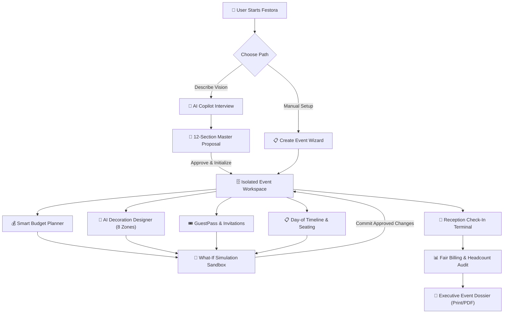
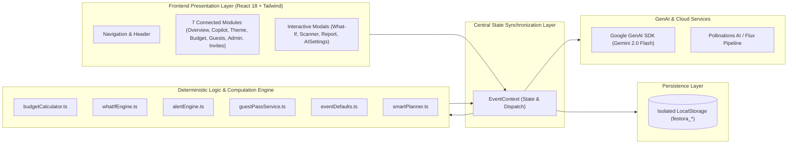

# Festora — Big moments. Beautifully planned.

<div align="center">


[](https://www.typescriptlang.org/)
[](https://react.dev/)
[](https://vitejs.dev/)
[](https://tailwindcss.com/)
[](https://aistudio.google.com/)
[](https://vitest.dev/)
[](#-17-contributing--license)

**An AI-powered, multi-event celebration planning and management workspace.**  
*Transforming event organization from messy spreadsheets and fragmented apps into a single, cohesive, AI-orchestrated reality.*

[Features](#-key-features) • [Architecture](#-architecture) • [GenAI Integrations](#-genai-integrations) • [Quickstart](#-installation--setup) • [What-If Engine](#-signature-feature-the-event-what-if-engine) • [Testing](#-testing--verification)

</div>

---

## 📖 Table of Contents

- [1. Project Overview & Identity](#-1-project-overview--identity)
- [2. Problem Statement](#-2-problem-statement)
- [3. The Festora Solution](#-3-the-festora-solution)
- [4. Key Features](#-4-key-features)
  - [AI Event Copilot](#-ai-event-copilot)
  - [Universal Multi-Event Workspaces](#-universal-multi-event-workspaces)
  - [AI Decoration Designer (8 Zones)](#-ai-decoration-designer)
  - [Smart Budget Planner](#-smart-budget-planner)
  - [Smart Invitations & GuestPass](#-smart-invitations--guestpass)
  - [Event Administration & Cockpit](#-event-administration--cockpit)
  - [Signature Event What-If Engine](#-signature-feature-the-event-what-if-engine)
  - [Executive Event Dossier](#-executive-event-dossier-report)
- [5. User Journey & Workflow](#-5-user-journey--workflow)
- [6. Architecture & System Design](#-6-architecture--system-design)
- [7. Technology Stack](#-7-technology-stack)
- [8. GenAI Integrations](#-8-genai-integrations)
- [9. Visual Tour & Screenshots](#-9-visual-tour--screenshots)
- [10. Project Structure](#-10-project-structure)
- [11. Installation & Setup](#-11-installation--setup)
- [12. Environment Variables](#-12-environment-variables)
- [13. Testing & Verification](#-13-testing--verification)
- [14. Deployment Guide](#-14-deployment-guide)
- [15. Security, Privacy & Integrity](#-15-security-privacy--integrity)
- [16. Product Roadmap](#-16-product-roadmap)
- [17. Contributing & License](#-17-contributing--license)

---

## 🌟 1. Project Overview & Identity

**Festora** (`Big moments. Beautifully planned.`) is an AI-first event planning and operational management platform that enables individuals, hosts, committee leaders, and professional organizers to conceive, budget, design, coordinate, and execute celebrations of any scale.

### Supported Event Types
Festora is built from the ground up to support the full spectrum of human celebration:
- 🎂 **Birthdays & Milestones**: Kids parties, sweet sixteens, golden jubilees.
- 💍 **Weddings & Receptions**: Sangeet, haldi, ceremonies, grand banquets.
- 🎓 **College Fests & Cultural Meets**: Technical symposia, concerts, battle of the bands.
- 🏢 **Corporate Summits & Offsites**: Product launches, seminars, annual galas.
- 🥂 **Anniversaries & Vow Renewals**: Intimate family dinners, milestone celebrations.
- 🏡 **Family & Community Functions**: Housewarmings, reunions, festival gatherings.
- ✨ **Custom Celebrations**: Tailored ground-up events with custom agendas and themes.

---

## 🛑 2. Problem Statement

Organizing a celebration today is notoriously stressful, inefficient, and fragmented:
1. **Tool Sprawl**: Hosts juggle WhatsApp groups for RSVPs, Excel sheets for budgeting, Pinterest boards for decor ideas, Canva for invites, and physical notebooks for day-of vendor tasks.
2. **Disconnected Headcounts and Costs**: A sudden change in guest count (+30 attendees) forces manual recalculations across catering plates, return gifts, seating arrangements, and hall size.
3. **The "What-If" Blindspot**: Organizers cannot safely experiment with trade-offs (*"What if we book a heritage courtyard instead of a hotel hall? How much does decor need to shrink to stay under ₹5,00,000?"*) without corrupting live event data.
4. **Day-of Reception Chaos**: Paper guest lists cause long queues at entry gates, unchecked duplicate passes, and caterer overbilling due to unverified attendance figures.
5. **Generic, Impersonal AI**: Existing AI chat tools offer high-level advice but cannot translate ideas into structured, actionable line items connected to real budgets, schedules, and decor concepts.

---

## 💡 3. The Festora Solution

Festora eliminates tool sprawl by providing a **single, connected, deterministic operating system** for your celebration:

```
    ┌────────────────────────────────────────────────────────┐
    │              FESTORA EVENT OS WORKSPACE                │
    ├───────────────────┬────────────────────────────────────┤
    │  GENAI COPILOT    │  Natural-language interview &      │
    │                   │  12-section master proposals       │
    ├───────────────────┼────────────────────────────────────┤
    │  DECOR DESIGNER   │  Photorealistic AI renders across  │
    │                   │  8 zones linked to budget          │
    ├───────────────────┼────────────────────────────────────┤
    │  BUDGET PLANNER   │  Deterministic math, guest-scaling,│
    │                   │  fixed vs variable expense engine  │
    ├───────────────────┼────────────────────────────────────┤
    │  SMART GUESTPASS  │  Encrypted QR passes & real-time   │
    │                   │  duplicate-preventing check-in     │
    ├───────────────────┼────────────────────────────────────┤
    │  WHAT-IF ENGINE   │  Zero-risk simulation sandbox with │
    │                   │  atomic commit capabilities        │
    └───────────────────┴────────────────────────────────────┘
```

Every module shares the same underlying domain state. When you adjust guest counts in the What-If sandbox or approve an AI Copilot proposal, changes flow synchronously into budget calculations, catering buffers, seating charts, and milestone timelines.

---

## ⚡ 4. Key Features

### 🤖 AI Event Copilot
- **Conversational Intelligence**: Integrated directly with **Google Gemini 2.0 Flash** via `@google/genai` with an autonomous heuristic fallback engine (`smartPlanner.ts`) that functions seamlessly even offline or without an API key.
- **Dynamic Context-Aware Interviewing**: Listens to broad prompts (*"Plan a 21st birthday for 150 people with live music in Bengaluru"*), extracts available parameters, and asks only missing, event-specific follow-up questions.
- **12-Section Master Event Proposals**:
  1. *Executive Overview & Celebration Vision*
  2. *Requirements & Deliverables Matrix*
  3. *Venue Layout & Floorplan Arrangements*
  4. *Guest Attendance & Headcount Planning*
  5. *Itemized Transparent Budget Breakdown*
  6. *Catering & Culinary Menu Recommendations*
  7. *Theme, Palette & Decor Concept Guidelines*
  8. *Return Gift & Favor Recommendations*
  9. *Entertainment, Emcee & Music Programming*
  10. *Day-of Execution Timeline*
  11. *Milestone Task List & Deadlines*
  12. *Risk Assessment & Contingency Mitigations*
- **One-Click Workspace Instantiation**: Approving a proposal instantly initializes an isolated event workspace, populates itemized budget lines, registers tasks, and creates decor concepts.
- **Voice Recognition**: Native voice-to-text dictation using the browser's Web Speech API.

### 🗂️ Universal Multi-Event Workspaces
- **Strict Data Isolation**: Manage multiple simultaneous celebrations (e.g. *Rohan's 25th Birthday* and *Zenith College Cultural Fest*).
- **Event Switcher Modal**: Effortlessly switch workspaces, duplicate an event as a template, or delete completed celebrations.
- **Zero Mock Contamination**: New users start with a clean slate; sample weddings are available strictly as an optional demonstration.

### 🎨 AI Decoration Designer
- **Photorealistic Concept Generation**: High-resolution concept visuals generated via the Pollinations AI / Flux pipeline across **all 8 celebration zones**:
  1. *Entrance & Welcome Area* (Floral arches, signage, lantern walkways)
  2. *Main Stage & Focal Area* (Ceremonial riser, acoustic panels, backdrop)
  3. *Guest Seating Arrangement* (Banquet chairs, ergonomic lounge pods)
  4. *Dining & Buffet Station* (Canopy draping, food presentation, warm lighting)
  5. *Table Decorations & Centerpieces* (Floral urns, hurricane vases, runners)
  6. *Lighting & Ceiling Canopy* (Cascading fairy lights, chandeliers, pin-spots)
  7. *Outdoor Lawns & Patio* (Festoon strings, garden gazebos, path lights)
  8. *Complete 360° Holistic Venue Concept* (Unified architectural view)
- **Venue Photo Reference Upload**: Upload actual photos of your venue to ground decor concepts in physical architecture.
- **Material & Cost Itemization**: Each concept includes materials, labor cost estimates, and actionable cost-saving alternatives.
- **One-Click Budget Connection**: Directly link any generated decor concept to the live event decor budget.

### 💰 Smart Budget Planner
- **Deterministic Math Engine**: Built on `budgetCalculator.ts`—no fuzzy estimations.
- **Fixed vs. Variable Cost Allocation**: Differentiates between static fees (hall rental, DJ, photography) and guest-scaled costs (per-plate catering, welcome kits, favors).
- **Home Courtyard Venue Discount**: Automatically waives commercial hall rental fees when an intimate home or lawn venue is selected.
- **Live Category Auto-Balancing**: Rebalances target allocations across Venue, Catering, Decor, Photography, Entertainment, and Contingency with a single click.
- **Emergency Buffer Management**: Configurable 5–15% contingency reserves to protect against day-of surprises.

### 🎟️ Smart Invitations & GuestPass
- **Unique Cryptographic Guest Passes**: Every party receives a formatted guest code (e.g., `FEST-BD-101`) and a scannable JSON-encoded QR pass.
- **Reception Scanner & Duplicate Prevention**: Dedicated organizer check-in terminal. Validates passes instantly and strictly rejects duplicate pass reuse.
- **AI Invitation Copywriter**: Dynamically drafts personalized invitation copy in 4 tones (*Formal & Prestigious*, *Warm & Casual*, *Royal & Traditional*, *Energetic & Fun*).
- **Multi-Style Invitation Studio**: Choose between *Royal Festive*, *Modern Minimalist*, and *Classic Botanical* visual cards with instant PNG download.
- **CSV Import & Export**: Bulk import guest lists with party sizes and dietary preferences from CSV/Excel files; export live RSVP reports.

### 📋 Event Administration & Cockpit
- **Day-of Hourly Timeline Builder**: Manage minute-by-minute vendor arrivals, ceremonies, meals, and cleanups with live status checkboxes.
- **Interactive Seating Layout Planner**: Allocate guests to banquet tables with real-time capacity and dietary breakdown indicators.
- **Weather Advisory Widget**: Real-time atmospheric forecasts and tactical operational advisories for outdoor venues.
- **Fair Billing Reconciliation**: Compares caterer minimum guaranteed plates against verified gate check-ins to prevent overpaying for no-shows.
- **Automated Operational Alerts**: Real-time warnings for budget overruns, pending RSVP deadlines, and overdue critical milestones.

### 🧪 Signature Feature: The Event What-If Engine
Stress-test event adjustments without endangering live event records:
- **Multi-Slider Simulation**:
  - Headcount Shift (-50 to +100 guests)
  - Target Budget Shift (-40% to +40%)
  - Venue Type Switch (Banquet Hall, Resort, Courtyard, Beachfront)
  - Decor Style Tier (Minimalist -30% to Luxury +40%)
- **Side-by-Side Trade-Off Analysis**: Highlights positive impacts (savings, intimacy) alongside operational challenges (hall capacity warnings, catering surge).
- **Atomic Scenario Commit**: Apply simulated scenarios to live event data only upon explicit confirmation.

### 📄 Executive Event Dossier Report
- Complete printable dossier modal aggregating event vitals, budget variance, guest RSVP breakdown, day-of timeline, and vendor contacts.
- Formatted with dedicated `@media print` CSS rules for clean export to physical paper or PDF.

---

## 🗺️ 5. User Journey & Workflow



---

## 🏗️ 6. Architecture & System Design

Festora is built as a **local-first, ultra-responsive single-page application** with clean architectural boundaries:



### Key Architectural Tenets
1. **Separation of Concerns**: UI modules contain zero mathematical formulas; all calculations are executed by deterministic pure functions in `services/`.
2. **State Isolation**: Every event's data is partitioned in localStorage under unique keys (`festora_event_${id}`, `festora_guests_${id}`, `festora_budget_${id}`).
3. **Graceful Fallbacks**: If network calls to Google Gemini fail or no API key is provided, Festora falls back instantly to the built-in smart planner without throwing uncaught exceptions.

---

## 💻 7. Technology Stack

| Category | Technology | Version | Purpose in Festora |
|---|---|---|---|
| **Core Framework** | React | `18.3.1` | Component-based UI and reactive state tree |
| **Build Tool** | Vite | `6.0.7` | Blazing-fast HMR and optimized production bundling |
| **Language** | TypeScript | `~5.6.3` | Strict type safety and interface definitions |
| **Styling** | Tailwind CSS | `^3.4.17` | Responsive styling and custom Festora palette |
| **AI LLM** | `@google/genai` | `^2.32.0` | Official Google GenAI SDK for Gemini 2.0 Flash |
| **Image Generation** | Pollinations AI | Flux Engine | Free, zero-key REST API for 8-zone architectural decor renders |
| **Icons** | Lucide React | `^1.16.0` | High-clarity SVG iconography |
| **QR Code Engine** | `qrcode` | `^1.5.4` | Generates scannable QR passes for guests |
| **Visual Effects** | `canvas-confetti` | `^1.9.4` | Reception check-in celebration feedback |
| **Test Suite** | Vitest | `^2.1.8` | High-speed unit and end-to-end integration tests |

---

## 🔮 8. GenAI Integrations

Festora integrates Generative AI responsibly with strict input sanitization, bounded prompts, and graceful offline fallbacks.

### 1. Google Gemini 2.0 Flash (`@google/genai`)
- **Integration**: Official Google GenAI SDK initialized in `src/services/geminiService.ts`.
- **Configuration**: Configurable via `.env.local` (`VITE_GEMINI_API_KEY`) or via the in-app **AI Settings Modal** (`⚙️ AI Settings`).
- **Prompt Defense**: Uses `src/lib/sanitize.ts` to sanitize inputs, stripping ChatML tokens, LLM instruct jailbreak sequences, and control characters before transmission.
- **Autonomous Fallback**: When no API key is detected, `callGeminiOrFallback` transparently invokes `smartPlanner.ts`, extracting event metadata and constructing full 12-section proposals locally.

### 2. Pollinations AI / Flux Image Generation Pipeline
- **Integration**: Implemented in `src/services/imageGenService.ts`.
- **Zero API Key Barrier**: Uses the high-performance Flux model via Pollinations AI.
- **Zone-Specific Prompt Synthesis**: Systematically compiles architectural prompts tailored to the event type, chosen color palette, venue architecture, and optional uploaded venue photos.

---

## 📸 9. Visual Tour & Screenshots

*(Representative placeholders reflecting current verified application interface)*

| Module | Preview Description |
|---|---|
| **AI Event Copilot** | *Interactive natural-language interview showing 12-section structured proposal cards, action diffs, and voice dictation.* |
| **Decoration Designer** | *Side-by-side gallery of 8 celebration zones generated via Flux with cost breakdowns and budget linking.* |
| **Smart Budget Planner** | *Live progress bars, fixed vs. guest-dependent cost tables, auto-balancing controls, and emergency contingency buffers.* |
| **GuestPass & Reception Scanner** | *Scannable QR cards with dietary badges, alongside the organizer's live gate verification camera/manual terminal.* |
| **What-If Simulation Sandbox** | *Interactive 4-slider panel showing real-time cost differences and operational trade-offs before committing changes.* |
| **Executive Event Dossier** | *Printable summary report ready for day-of coordination and PDF generation.* |

---

## 📁 10. Project Structure

```
d:/festora/
├── .env.example             # Documented environment variable template
├── .gitignore               # Excludes secrets, node_modules, and dist artifacts
├── index.html               # Main entry HTML with font preconnects and theme styles
├── package.json             # Dependencies, scripts, and build metadata
├── postcss.config.js        # PostCSS configuration for Tailwind CSS
├── tailwind.config.js       # Custom Festora palette (#FFF8EF, #C96F4A, #D9A948, etc.)
├── tsconfig.json            # Base TypeScript configuration
├── tsconfig.app.json        # Application-specific compiler options
├── tsconfig.node.json       # Node environment compiler options
├── vite.config.ts           # Vite bundler configuration with manual chunk splitting
├── src/
│   ├── main.tsx             # React DOM root entry point
│   ├── App.tsx              # Application shell, module switcher, and modal router
│   ├── index.css            # Tailwind directives, print media styles, and animations
│   ├── types/
│   │   └── index.ts         # Central TypeScript interfaces (EventDetails, Guest, etc.)
│   ├── context/
│   │   └── EventContext.tsx # Central state provider syncing state to storage
│   ├── lib/
│   │   ├── errors.ts        # Typed error hierarchy (AppError, ValidationError, etc.)
│   │   ├── logger.ts        # Severity-tagged structured console logging
│   │   ├── sanitize.ts      # Prompt injection defenses and input sanitization
│   │   └── seedData.ts      # Optional sample wedding demonstration data
│   ├── services/
│   │   ├── alertEngine.ts       # Deterministic operational alerts
│   │   ├── budgetCalculator.ts  # Unified math calculations for budget and What-If
│   │   ├── copilotService.ts    # AI Copilot dispatcher
│   │   ├── eventDefaults.ts     # Domain knowledge defaults for 7 event types
│   │   ├── geminiService.ts     # Google GenAI SDK integration with fallback
│   │   ├── guestPassService.ts  # QR generation and duplicate check-in validation
│   │   ├── imageGenService.ts   # Pollinations AI Flux prompt builder for 8 zones
│   │   ├── smartPlanner.ts      # Heuristic entity extraction and 12-section proposal
│   │   ├── storageService.ts    # Isolated localStorage persistence layer
│   │   └── whatIfEngine.ts      # Pure-function simulation sandbox
│   ├── components/
│   │   ├── layout/
│   │   │   └── Header.tsx               # Responsive header with navigation drawer
│   │   ├── modules/
│   │   │   ├── OverviewModule.tsx       # Celebration dashboard & quick vitals
│   │   │   ├── CopilotModule.tsx        # AI interview & master proposal cards
│   │   │   ├── ThemeModule.tsx          # 8-zone decoration designer & photo upload
│   │   │   ├── BudgetModule.tsx         # Expense table, auto-balance & categories
│   │   │   ├── GuestsModule.tsx         # Guest directory, seating chart & CSV tools
│   │   │   ├── AdminModule.tsx          # Hourly timeline, fair billing & weather
│   │   │   └── InvitationPreviewModule.tsx # Multi-style invitations & AI copywriter
│   │   └── modals/
│   │       ├── AISettingsModal.tsx      # In-app Gemini API key & model settings
│   │       ├── CheckInScannerModal.tsx  # Reception check-in terminal with camera/code
│   │       ├── CreateEventModal.tsx     # Wizard to instantiate new celebrations
│   │       ├── EventReportModal.tsx     # Printable Executive Event Dossier
│   │       ├── EventSwitcherModal.tsx   # Workspace switcher, duplicate & delete
│   │       ├── GuestPassModal.tsx       # Scannable QR pass viewer and download
│   │       └── WhatIfModal.tsx          # 4-slider What-If scenario sandbox
│   └── __tests__/
│       ├── alertEngine.test.ts      # Tests for alert trigger conditions
│       ├── budgetCalculator.test.ts # Tests for fixed/variable/home venue costs
│       ├── e2eWorkflow.test.ts      # 11-step end-to-end user workflow test suite
│       ├── guestPassService.test.ts # Tests for QR codes & duplicate check-in defense
│       └── whatIfEngine.test.ts     # Tests for non-destructive scenario simulation
```

---

## 🚀 11. Installation & Setup

### Prerequisites
- **Node.js**: `v18.0.0` or higher (Node 20+ recommended)
- **NPM**: `v9.0.0` or higher (comes bundled with Node.js)
- **Git**: Installed and configured

### Step-by-Step Instructions

1. **Clone the Repository**:
   ```bash
   git clone https://github.com/bajaysingh1710/Festora.git
   cd Festora
   ```

2. **Install Dependencies**:
   ```bash
   npm install
   ```

3. **Configure Environment Variables**:
   Copy the example environment file:
   ```bash
   cp .env.example .env.local
   ```
   *(Optional)* Open `.env.local` and add your Google Gemini API key:
   ```env
   VITE_GEMINI_API_KEY=your_gemini_api_key_here
   ```
   > **Note**: An API key is optional! Festora automatically uses its built-in smart planner fallback engine if no key is supplied. You can also configure the key at runtime inside the app via `⚙️ AI Settings`.

4. **Start the Development Server**:
   ```bash
   npm run dev
   ```
   Open your browser and navigate to `http://localhost:3000`.

5. **Build for Production**:
   ```bash
   npm run build
   ```
   The compiled assets will be output to the `dist/` folder.

6. **Preview Production Build**:
   ```bash
   npm run preview
   ```

---

## 🔑 12. Environment Variables

All environment variables are documented in `.env.example`:

| Variable | Required | Default Value | Description |
|---|---|---|---|
| `VITE_GEMINI_API_KEY` | **No** | `""` | Google Gemini API key for genuine LLM copilot responses |
| `VITE_GEMINI_MODEL` | **No** | `gemini-2.0-flash` | Gemini model name (`gemini-2.0-flash`, `gemini-1.5-flash`) |
| `VITE_APP_URL` | **No** | `http://localhost:3000` | Application root URL for invitation links |

> 🔒 **Security Notice**: Never commit `.env` or `.env.local` with real keys to Git. Only `.env.example` should be tracked.

---

## 🧪 13. Testing & Verification

Festora features a comprehensive test suite powered by **Vitest**, covering unit math, security boundaries, duplicate check-in prevention, and complete end-to-end user workflows.

### Run All Tests
```bash
npm test
```

### Run Typecheck
```bash
npm run typecheck
```

### Test Suite Summary (26 Tests Across 5 Test Files)
- `src/__tests__/budgetCalculator.test.ts` (4 tests):
  - Fixed cost calculation invariance against guest headcount
  - Dynamic scaling of guest-dependent catering and party favors
  - Application of home courtyard venue discounts
  - Over-budget detection and overrun amount calculation
- `src/__tests__/guestPassService.test.ts` (5 tests):
  - Structured QR JSON payload verification
  - First-time valid check-in verification
  - **Duplicate check-in prevention** (strictly rejects reuse of checked-in codes)
  - Declined RSVP check-in interception
  - Malformed or non-existent pass code handling
- `src/__tests__/whatIfEngine.test.ts` (3 tests):
  - Verification that original event and budget data remain 100% untouched
  - Cost increase and trade-off calculation for guest additions
  - Commercial venue fee elimination savings calculation
- `src/__tests__/alertEngine.test.ts` (3 tests):
  - Budget overrun alert triggering
  - Pending RSVP deadline alerts
  - Critical milestone task alerts
- `src/__tests__/e2eWorkflow.test.ts` (11 tests):
  - Clean slate verification for new users
  - Birthday celebration creation with 200 guests
  - Copilot 12-section proposal generation
  - Proposal conversion to live event & budget
  - Photorealistic decor image generation across 8 required zones
  - Guest pass generation, QR verification, and duplicate check-in prevention
  - What-If simulation with +30 guests without mutating live event
  - Multi-event isolation between Birthday and College Fest
  - Day-of hourly schedule milestones and toggle completion
  - Attendance fair billing reconciliation against caterer guarantees

---

## 🌐 14. Deployment Guide

Festora is optimized for immediate zero-config deployment on static web platforms:

### Deploying on Vercel
1. Push your repository to GitHub.
2. Log in to [Vercel](https://vercel.com/) and click **Add New Project**.
3. Import your `Festora` repository.
4. Set Build Command: `npm run build`
5. Set Output Directory: `dist`
6. *(Optional)* Add `VITE_GEMINI_API_KEY` under **Environment Variables**.
7. Click **Deploy**.

### Deploying on Netlify / Cloudflare Pages / GitHub Pages
- **Build Command**: `npm run build`
- **Publish Directory**: `dist`
- **SPA Fallback**: Configure single-page rewrite to `/index.html` (for Vite SPAs).

---

## 🛡️ 15. Security, Privacy & Integrity

- **Prompt Injection Hardening**: Implemented in `src/lib/sanitize.ts`. Strips `[INST]`, `[/INST]`, `<|im_start|>`, `<|im_end|>`, control characters, and markdown escape sequences.
- **Prototype Pollution Defense**: Key validator rejects `__proto__`, `constructor`, and `prototype` in dynamic object manipulation.
- **Local-First Data Privacy**: All event data, guest lists, and financial figures remain strictly on the user's client machine in `localStorage`. No external server retains host or guest contact details.
- **Zero Committed Secrets**: The repository `.gitignore` strictly ignores `.env*` files, preventing accidental leakage of credentials.

---

## 🗺️ 16. Product Roadmap

### Completed Features (v1.0.0 Release)
- [x] Multi-event isolated workspace management (create, switch, duplicate, delete)
- [x] AI Event Copilot with Google Gemini 2.0 Flash and local smart planner fallback
- [x] 12-Section Master Event Proposals with voice recognition input
- [x] AI Decoration Designer generating 8 distinct celebration zones via Flux
- [x] Venue reference photo upload with architectural grounding
- [x] Deterministic Budget Planner with fixed vs. variable expense scaling
- [x] Smart Invitations with 3 visual templates and AI copywriting in 4 tones
- [x] Unique QR GuestPass generator and Reception Check-In Scanner
- [x] Strict duplicate pass reuse prevention engine
- [x] Signature Event What-If Engine with 4-slider sandbox and atomic commit
- [x] Day-of hourly timeline builder and seating chart layout planner
- [x] Fair billing reconciliation and weather advisory widget
- [x] Executive Event Dossier with print-ready CSS export

### Future Horizons (Planned)
- [ ] Direct WhatsApp Business Cloud API integration for automated RSVP delivery
- [ ] Multi-user real-time collaboration via WebSockets
- [ ] Vendor bidding portal where local decorators can quote against generated concepts
- [ ] Multi-currency support (USD, EUR, GBP, AED, INR)

---

## 🤝 17. Contributing & License

### Contributing
Contributions to Festora are welcome! Please follow these steps:
1. Fork the repository.
2. Create a descriptive feature branch: `git checkout -b feature/amazing-feature`.
3. Commit your changes: `git commit -m 'feat: add amazing feature'`.
4. Ensure all tests and typechecks pass: `npm test && npm run typecheck`.
5. Push to your branch: `git push origin feature/amazing-feature`.
6. Open a Pull Request.

### License
The license for this project has not yet been specified. All rights are reserved by the project author unless explicitly stated otherwise.

---

<div align="center">

**Festora** — *Big moments. Beautifully planned.*  
Built with passion for organizers, hosts, and celebrants everywhere.

</div>
